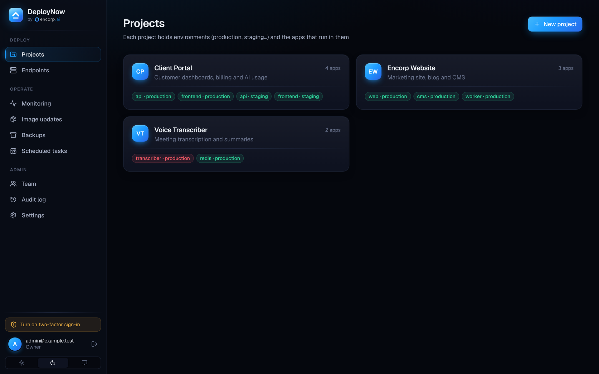
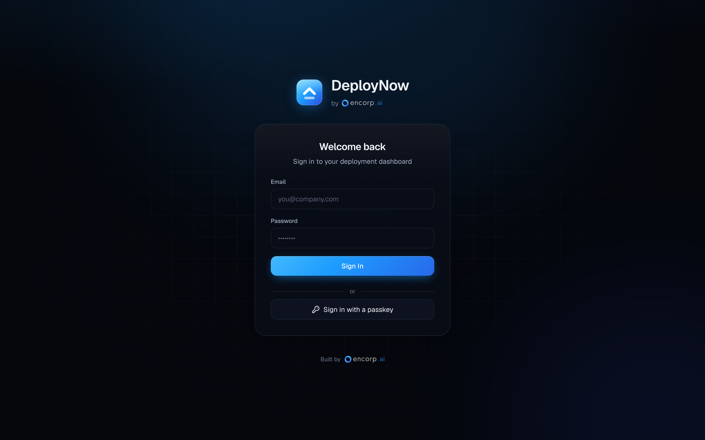
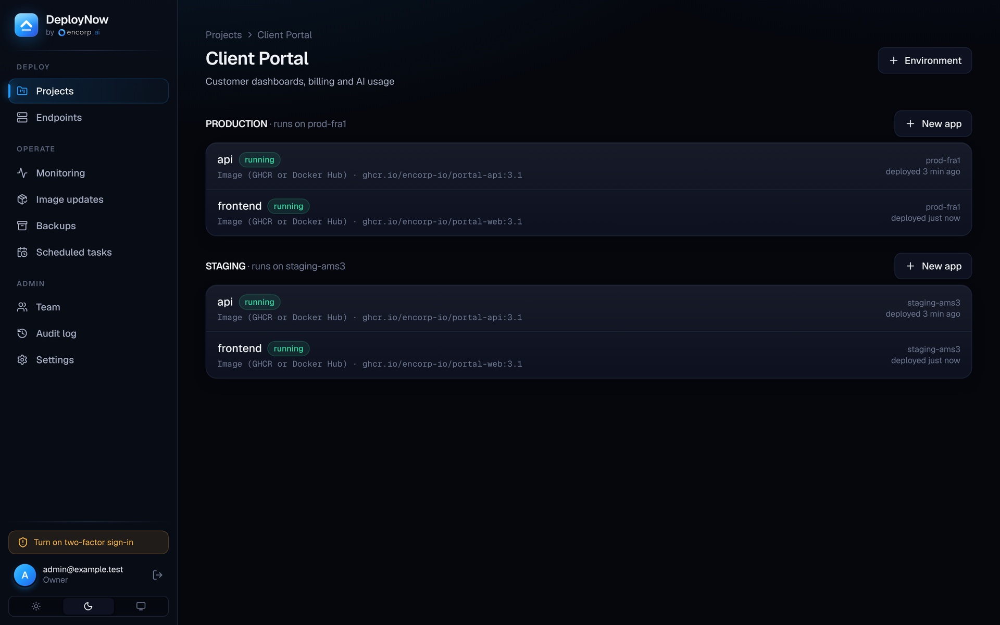
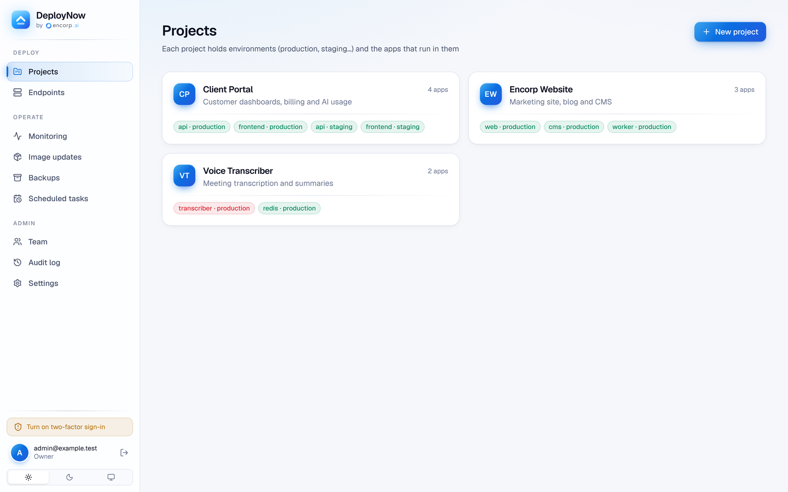

<div align="center">

<picture>
  <source media="(prefers-color-scheme: dark)" srcset="brand/deploynow-logo-dark.svg">
  
</picture>

**Ship to every Docker machine you own.**<br>
Self-hosted control plane for your Docker machines: deploy apps, manage containers, back up data and watch it all from one place.

[Quick start](#quick-start) · [Docs](docs/v2.md) · [encorp.ai](https://encorp.ai)

[](https://github.com/encorp-io/deploynow/actions/workflows/ci.yml)
[](https://github.com/encorp-io/deploynow/actions/workflows/docker-publish.yml)
[](LICENSE)
[](https://encorp.ai)

<br>



</div>

**DeployNow by [encorp.ai](https://encorp.ai)** replaces Portainer and Dokploy with one app. It talks to Docker directly on the machine it runs on and on remote machines, deploys your apps from images or Git, puts them behind Traefik with SSL, and backs up their data with encrypted restic snapshots. It runs as a single container with an embedded SQLite database.

> DeployNow is v2 of Encorp Deployer, the Portainer update helper. Coming from v1? See [Upgrading from v1](docs/v2.md#upgrading-from-v1).

## A look inside

DeployNow ships with a dark theme by default and a matching light theme. Switch between light, dark and your system setting from the bottom of the sidebar.

<table>
  <tr>
    <td width="50%"></td>
    <td width="50%"></td>
  </tr>
  <tr>
    <td width="50%"></td>
    <td width="50%"></td>
  </tr>
</table>

## Features

**Machines and containers**
- Manage the local Docker socket, machines over SSH or TLS, and machines behind NAT through a small outbound agent (mutual TLS, no open port needed).
- Container explorer: start, stop, restart, remove, inspect, live logs and stats, and an in-browser console.
- Images, volumes, networks and prune. Image update checks with auto-update for floating tags such as `latest`.

**Apps and deploys**
- Projects with environments (`production`, `staging`, ...) holding apps.
- Deploy from a GHCR or Docker Hub image, a Dockerfile in Git, a compose file in Git, or a pasted compose file.
- Zero-downtime replace for stateless apps, a full log for every deployment, and one-click rollback.
- Push-to-deploy from GitHub webhooks, and pull request previews at `pr-<n>.<your preview domain>`.
- Optional build server that builds and pushes to your registry, then pulls on the target. Private registry logins.
- Environment variables and secrets: secrets are encrypted at rest and masked in logs, with optional HashiCorp Vault references.

**Domains and SSL**
- Managed Traefik with Let's Encrypt, by HTTP challenge or Cloudflare DNS. Or join an existing Traefik, such as Dokploy's, to migrate one app at a time.
- Redirects (301 to 308) and password protection per domain.

**Backups**
- restic backups to Cloudflare R2, AWS S3, Backblaze B2 or any S3 service, encrypted before upload.
- Volumes, host folders, databases (Postgres, MySQL/MariaDB, MongoDB, Redis), whole apps, and DeployNow itself, with retention.
- Restore to the original place, a new volume or a database, and monthly automatic restore drills.

**Operations**
- Scheduled tasks (cron) in a container or a one-off container.
- Monitoring and alerts for disk, memory, crash loops, offline agents and failed deploys, backups or tasks.
- Notifications to Slack, Discord, Telegram, email (SMTP) or a signed webhook.

**Security and access**
- Two-factor authentication (TOTP), passkeys, and single sign-on with Google, Microsoft or any OpenID Connect provider.
- Roles (viewer, operator, admin, owner) with per-endpoint and per-project grants.
- A fresh 2FA code for destructive actions, server-side sessions you can revoke, and an audit log.
- API tokens, an OpenAPI description at `/api/openapi.json`, and the `deploynow` CLI.
- AI connectors: a built-in MCP server at `/mcp` with OAuth sign-in, so you can run DeployNow from Claude, ChatGPT and other AI apps. See [docs/ai-connectors.md](docs/ai-connectors.md).

## Quick start

You need a Linux machine with Docker.

```bash
git clone https://github.com/encorp-io/deploynow.git
cd deploynow

cat > .env <<EOF
AUTH_SECRET=$(openssl rand -base64 32)
ADMIN_EMAIL=you@example.com
ADMIN_PASSWORD=choose-a-long-password
NEXTAUTH_URL=https://your-server:9444
DOCKER_GID=$(stat -c %g /var/run/docker.sock)
EOF

docker compose up -d
```

While the repository is private, the image on GHCR is private too: run `docker login ghcr.io` with a GitHub token that has `read:packages` before `docker compose up`.

Open `https://your-server:9444` and sign in. The certificate is self-signed until you mount your own (see `docker-compose.yml`).

1. Set up 2FA or a passkey when asked. Admins must have one.
2. The local machine is already added as the `local` endpoint. Add others under **Endpoints**: SSH, TLS, or **Agent** for a machine behind NAT, where you copy the `docker run` command shown.
3. On an endpoint, set up the edge proxy (managed Traefik or an existing one) if you want domains.
4. Optional: under **Settings → Domain**, serve DeployNow itself on a domain such as `deploy.example.com`. It goes through the local endpoint's edge proxy with a Let's Encrypt certificate, and port 9444 keeps working as a fallback.
5. Create a project and an app, add its domain and environment variables, and deploy.
6. Under **Backups**, add an R2 or S3 destination and a policy. Save the recovery kit it shows you.

Ports: `9444` for the dashboard and `8444` for agents. You can leave 8444 closed if you don't use agents.

> Mounting the Docker socket gives root on that machine. Anyone who is an admin in DeployNow, or an operator with console access, can act as root on every endpoint they can reach. Keep 2FA on.

## Documentation

- [docs/v2.md](docs/v2.md): everything in v2, phase by phase. It covers endpoints, apps, secrets, domains, roles, the agent, SSO, API tokens, previews, moving apps off Dokploy, and upgrading from v1.
- [docs/backups.md](docs/backups.md): backup setup, the recovery kit, restores, drills, and restoring DeployNow itself.

## CLI

```bash
npm install -g ./cli
deploynow login --url https://your-server:9444 --token dn_...   # token from Account → API tokens
deploynow apps
deploynow deploy shop/production/web
deploynow rollback shop/production/web <deployment-id>
deploynow backup <policy-id>
deploynow api GET /endpoints
```

`DEPLOYNOW_URL` and `DEPLOYNOW_TOKEN` override the saved login, for CI. Run `deploynow help` for every command.

## Environment variables

| Variable | Required | Default | Description |
|---|---|---|---|
| `AUTH_SECRET` | **Yes** | | Signs sessions and encrypts stored secrets. Keep it safe: if it changes, stored secrets can't be read. `openssl rand -base64 32` |
| `ADMIN_EMAIL` | No | `admin@encorp.io` | Owner account created on first boot |
| `ADMIN_PASSWORD` | First boot | | Password for that account, at least 12 characters |
| `NEXTAUTH_URL` | Recommended | from the request | Public URL. Used for links, SSO and the agent address. A domain set under Settings → Domain takes precedence |
| `IGNORE_PLATFORM_DOMAIN` | No | | `true` ignores the domain stored under Settings → Domain, if it ever needs bypassing without the UI |
| `UI_HTTP_PORT` | No | `9080` | Internal plain-HTTP port Traefik forwards the platform domain to. Not published on the host |
| `DATABASE_URL` | No | `file:/data/deployer.db` | SQLite path |
| `DOCKER_GID` | With the socket | `999` | Group of `/var/run/docker.sock` |
| `DEPLOYNOW_DATA_DIR` | No | the database's folder | Deploy logs, build checkouts and backup staging |
| `AGENT_PORT` | No | `8444` | Port agents connect to; `off` disables it |
| `AGENT_PUBLIC_URL` | No | the platform domain's or `NEXTAUTH_URL`'s host on `AGENT_PORT` | Address agents dial. Can also be set under Settings |
| `AGENT_IMAGE` | No | `ghcr.io/encorp-io/deploynow-agent:latest` | Agent image in the join command |
| `RESTIC_IMAGE` | No | `restic/restic:0.18.1` | restic image used for backups on endpoints |
| `DEPLOYNOW_MCP` | No | `on` | `off` turns off the MCP server and OAuth for AI apps |
| `BACKUP_PARALLEL` | No | `2` | Backups that run at the same time |
| `GITHUB_USER`, `GITHUB_TOKEN` | No | | GHCR and private GitHub access. Can also be set under Settings |
| `CERT_FILE`, `KEY_FILE`, `TLS_HOSTNAME` | No | | Your own certificate, or a hostname for the self-signed one |

## Upgrading

```bash
docker compose pull
docker compose up -d
```

Schema changes are applied on start and only add tables and columns. Back up the `/data` volume first, or set up a DeployNow backup policy for the instance.

## Landing page

The product website lives in [`site/`](site/): static HTML and CSS with no build step, hosted on Cloudflare Pages (build command empty, output directory `site`). Setup steps and brand notes are in [`site/README.md`](site/README.md).

## How it's built

| Part | Technology |
|---|---|
| App | Next.js 16, React 19, Tailwind CSS v4, Geist type |
| Auth | NextAuth v5 with server-side sessions, TOTP, WebAuthn passkeys, OIDC |
| Data | SQLite through Prisma |
| Docker | dockerode, plus the Docker CLI with compose and buildx for builds |
| Edge | Traefik v3 |
| Backups | restic |
| Agent | Go (`agent/`), mutual TLS over WebSockets |
| CLI | Node 20, no dependencies (`cli/`) |

```
src/app/        pages and API routes
src/lib/        Docker, deploys, backups, agent hub, auth, notifications
agent/          deploynow-agent (Go)
cli/            deploynow CLI
tests/          unit, API and real-Docker integration tests
site/           landing page (Cloudflare Pages)
docs/           user documentation
brand/          logo, icons, colours and type (see brand/README.md)
```

## Development

```bash
npm install
cp .env.example .env        # set AUTH_SECRET
npx prisma db push
ADMIN_PASSWORD=dev-password-123 npx prisma db seed   # creates admin@encorp.io
npm run dev                 # http://localhost:3000
npm test                    # unit and API tests; integration tests run when Docker is available
```

CI runs the type check, tests with coverage (including real-Docker integration tests), the Go agent tests and a production build on every push. Pushing a `v*.*.*` tag publishes the app and agent images and creates a GitHub release.

## Brand

The DeployNow logo, the encorp.ai logo, icons, colours and type are in [`brand/`](brand/README.md). The app's colour tokens live in `src/app/globals.css`, so the whole UI follows one palette in both themes.

## License

MIT, see [LICENSE](LICENSE).

<div align="center">
<br>
<a href="https://encorp.ai">
  <picture>
    <source media="(prefers-color-scheme: dark)" srcset="brand/encorp-logo-white.svg">
    
  </picture>
</a>

DeployNow is built by [encorp.ai](https://encorp.ai)

</div>
